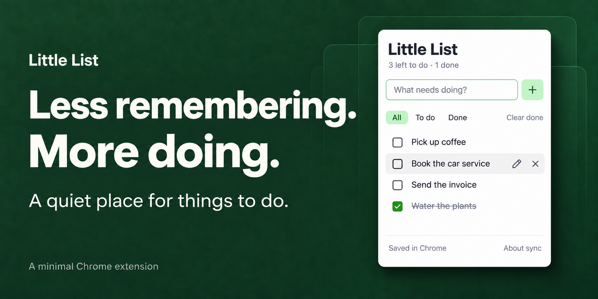

# Little List

**A quiet place for things to do.**

A small Chrome toolbar to-do list. Add a task, tick it off, get on with your day. Your list follows the Google account signed into Chrome through Chrome Sync.

[Install in Chrome](#install) · [Google account sync](#google-account-sync) · [Privacy](#privacy)

## Features

- Add, complete, edit, reopen, and delete tasks.
- Filter by **All**, **To do**, or **Done**, and clear completed tasks.
- See your unfinished task count on the toolbar icon.
- Open the list in its own tab when you want more room.
- Save offline; let Chrome sync when a connection is available.
- Use the keyboard throughout: **Enter** adds or saves; **Escape** cancels an edit.

The UI follows the same restrained styling as [Tabs](https://github.com/nickdc8/tab-manager): white surfaces, system type, compact rows, and soft green accents.

## Install

1. [Download the ZIP](https://github.com/nickdc8/little-list/archive/refs/heads/main.zip) and extract it, or clone this repository:

   ```sh
   git clone https://github.com/nickdc8/little-list.git
   ```

2. Open `chrome://extensions` in desktop Google Chrome and enable **Developer mode**.
3. Click **Load unpacked** and select the `little-list` folder containing `manifest.json`.
4. Pin **Little List** from the extensions menu, then click its toolbar icon.

No dependencies, build step, API key, or Google developer project required. Keep the folder in place after loading it. After updating the files, click **Reload** on the extension's card.

## Google account sync

This uses the Google account signed into **Chrome itself**. A Gmail login in a browser tab alone does not enable sync.

1. Sign into Chrome with your Google/Gmail account.
2. Open `chrome://settings/syncSetup` and enable syncing for **Extensions** (or sync everything).
3. Install this same extension on your other desktop computers and use the same Google account and sync settings there.

The manifest includes a fixed **public** key so unpacked installs keep the same extension ID, even in different folders or on different operating systems. Keep that key unchanged; a new ID gets separate storage. Unpacked extensions must be installed manually on each computer.

Tasks are stored with [`chrome.storage.sync`](https://developer.chrome.com/docs/extensions/reference/api/storage). Without sync, they still save on the current computer. With sync enabled, Chrome handles propagation to other computers, which can take time. “Saved in Chrome” confirms a browser storage write; it does not claim that another computer has received it. Chrome does not expose cloud upload status or the user's sync setting to this extension.

Each task has its own storage key, so changing one task does not rewrite your whole list. Simultaneous changes to the **same task** follow Chrome's sync conflict resolution; avoid editing the same task on two offline computers. This is a simple personal list, not a collaborative task manager.

The list supports up to **100 tasks**, each up to **240 characters**, to stay within Chrome's small sync-storage budget. Chrome can also temporarily limit writes; failed saves display an error and keep the add/edit draft available for retry. Clear completed tasks to free space. Sync storage has an approximately 100 KB total quota and an 8 KB per-item quota.

Desktop Google Chrome is the intended browser. Other Chromium browsers may support the extension, but their account syncing differs. Chrome mobile does not support this extension.

## Privacy

The only extension permission is **storage**. Little List cannot read your email, your browsing history, your open tabs, or your Google credentials. It has no analytics, remote scripts, third-party fonts, or application server. Google handles account authentication and Chrome Sync.

Your task text is stored by Chrome and, when enabled, synced through your Google account. It is not written to this repository. Removing the extension can remove its local storage; do not use it as the sole copy of irreplaceable information.

## Local preview

Serve the folder with any static server, for example:

```sh
python3 -m http.server 4317 --bind 127.0.0.1
```

Open `http://127.0.0.1:4317/popup.html`. The preview uses separate browser-local storage and clearly labels itself **Preview only**. It does not access the extension's tasks or Google Sync.

## Checks

```sh
npm test
```

Uses Node's built-in test runner; no packages need installing. Thirteen checks cover task lifecycle, cross-device task isolation, input validation, the task limit, quota failures, service-worker message handling, write serialization, the toolbar count, and popup interactions using a mocked DOM and Chrome API.

Browser preview was unavailable in the build session because permission to access the local preview was declined. Real cross-device Google Sync has not been verified; that requires installing the extension in two signed-in Chrome profiles with sync enabled.

## Share image

[`docs/images/social-preview.png`](docs/images/social-preview.png) is the 1280 × 640 GitHub share image. The matching README artwork is [`docs/images/hero.png`](docs/images/hero.png). Generated with the built-in image-generation tool using the Tabs banner as a style reference; the prompt is saved in [`design/hero-prompt.txt`](design/hero-prompt.txt).

GitHub's custom social preview is a repository setting, separate from the README image. Browser access to GitHub settings was declined in the build session, so the custom social preview has **not** been attached. To set it, open [**Settings → General**](https://github.com/nickdc8/little-list/settings), find **Social preview → Edit → Upload an image**, and select `social-preview.png`.

## License

[MIT](LICENSE)
